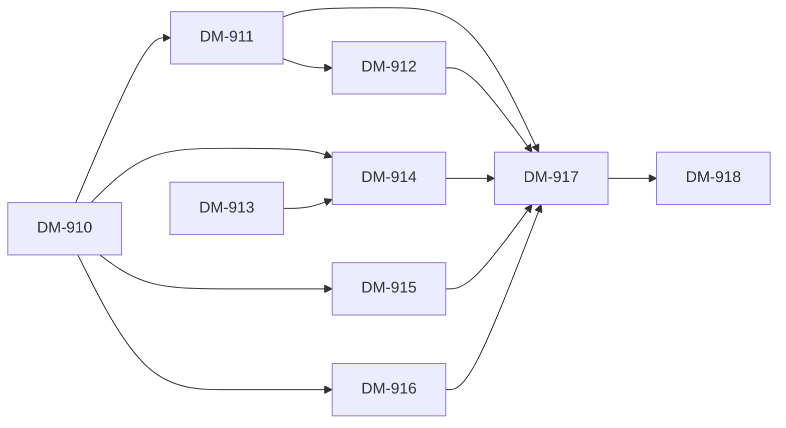

# Kế hoạch Phase 9 — i18n hoàn chỉnh

Tracking: GitHub issue #97 (epic) + #98–#106 (tasks), milestone **v0.2.0**.
Milestone v0.1.x, Phase 1–8 (DM-001…DM-806) đã hoàn thành (issues #1–#51 đóng).

## Trạng thái hiện có (verified 2026-11-17, master @ v0.1.7)

Đã có nền tảng i18n trong v0.1.x (Phase 7/#10):

- `LocaleInputSchema` (id BCP-47, `name?`, `base?`, `suffix?` loại trừ nhau), `resolveLocales()` — `packages/core/src/config.ts`.
- Route theo postfix tên file (`guide/intro.vi-VN.md`) — `packages/core/src/routes.ts`.
- `<html lang>` vào đúng locale của trang — `packages/core/src/build.ts` (wrap()).
- Nav/sidebar build per-locale, paginate same-locale — `packages/core/src/siteFeatures.ts`.
- Search index per-locale, worker drop index cũ khi đổi locale — `packages/core/src/search.ts`, `packages/core/src/client/search-client.ts`.
- `<html lang>` có test — `tests/html-lang.test.ts`.

Chưa có:

1. **Model cặp bản dịch** — `Route.id` giữ hậu tố nên `guide/intro` và `guide/intro.vi-VN` không có gì ràng buộc nhau; không thể trả lời "trang này bản tiếng Việt ở đâu".
2. **hreflang alternates** trong `<head>` (Google đòi URL tuyệt đối → chỉ hợp lệ khi có `sitemap.hostname`).
3. **Sitemap alternates** (`xhtml:link` + `x-default`).
4. **UI string** hardcode trong theme-default ("Bỏ qua điều hướng", "Tìm kiếm…", …) — trang tiếng Anh vẫn hiện tiếng Việt; `mergeLocaleStrings` trong theme resolver chưa được gọi.
5. **LanguageSwitcher** — không có slot, không có `useLocale()` / `useT()`.
6. **Link markdown** chưa locale-aware — `guide/intro.vi-VN.md` viết `[x](./other.md)` → trỏ bản en-US.
7. **Thiếu bản dịch im lặng** — build xanh kể cả khi toàn bộ trang chỉ có EN.

## Quyết định thiết kế

| Quyết định | Giá trị | Lý do |
| --- | --- | --- |
| Nguồn sự thật locale | Hậu tố tên file | Nhất quán DM-204; không thêm frontmatter.locale để tránh 2 nguồn |
| `Route.key` | Path locale-neutral (root = `''`) | Khoá chung cho cả cặp, không phụ thuộc base/suffix |
| `alternates` | `Record<localeId, path>` | Đủ dữ liệu cho hreflang + sitemap + switcher từ 1 nguồn |
| `byKey` trong RouteTable | `Record<key, Record<localeId, Route>>` | O(1) lookup cho báo thiếu bản dịch |
| `Route.id` | Giữ nguyên (vẫn có hậu tố) | Backward compatible với tests/theme hiện có (DM-204) |
| hreflang / x-default | Chỉ phát khi có `sitemap.hostname`, bỏ qua 404, x-default = locales[0] | Google đòi URL tuyệt đối; base locale là default |
| Switcher | Link path-based thuần, không redirect, không localStorage | SEO + đơn giản cho v0.2 |
| Thiếu bản dịch | Warning gom 1 lần; `i18n.requireParity: true` → lỗi build | Đừng spam log; CI opt-in strict |
| Theme messages | Nhúng `virtual:dommief/site` (`site.messages`) | Kích thước nhỏ; không thêm virtual module mới |
| Release | Publish chạy tay (workflow_dispatch) | Preference của user |

## Thứ tự thực hiện

DM-910 và DM-913 không phụ thuộc nhau → làm song song được.

- [DM-910](https://github.com/thnhtus/dommief/issues/98) Model route↔translation — P0
- [DM-911](https://github.com/thnhtus/dommief/issues/99) hreflang + x-default — P0
- [DM-912](https://github.com/thnhtus/dommief/issues/100) Sitemap alternates — P1
- [DM-913](https://github.com/thnhtus/dommief/issues/101) Theme i18n messages — P1
- [DM-914](https://github.com/thnhtus/dommief/issues/102) LanguageSwitcher — P0
- [DM-915](https://github.com/thnhtus/dommief/issues/103) Link locale-aware — P1
- [DM-916](https://github.com/thnhtus/dommief/issues/104) Báo thiếu bản dịch + requireParity — P2
- [DM-917](https://github.com/thnhtus/dommief/issues/105) Example 2 locale + e2e — P0
- [DM-918](https://github.com/thnhtus/dommief/issues/106) Docs + changelog + release 0.2.0 — P0

## Out of scope cho v0.2.0

- Tự động dịch nội dung (machine translation pipeline).
- Auto-redirect theo Accept-Language / cookie locale.
- Locale directory layout (`docs/en/`, `docs/vi/`) — giữ nguyên naming convention DM-204.
- Locale-specific slug mapping (vd `/guide/intro` vs `/guide/bat-dau`).
